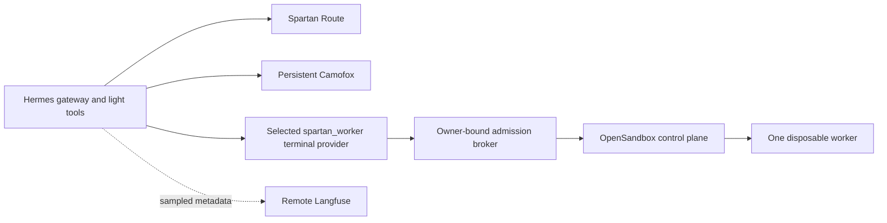

# Spartan Gate: implementation blueprint and ecosystem comparison

Date: 2026-10-02. Status: **design for review; none of the proposed runtime changes has been applied**.

For the shorter explanation, read the [version 2 plan](spartan-gate-plan-v2-2026-10-02.md) or open the [visual HTML guide](spartan-gate-plan-v2-2026-10-02.html). This blueprint retains the engineering details.

This is the concrete follow-up to the [first strategic assessment](spartan-gate-reimagining-2026-10-02.md). That document retains the measured host baseline and broader trust tradeoffs. This one supersedes its implementation sequencing: source inspection found useful native controls and integration hazards that the first pass missed.

## 1. Are we still on a good path?

**Yes on the boundary; less so on the amount of infrastructure we maintain around it.** Spartan Gate's useful distinction is a personal assistant with persistent accounts, subscription routing, private integrations, and a protected host. It should not compete with Hermes on agent execution, with Langfuse on trace exploration, or with a sandbox project on container lifecycle.

The ecosystem is not converging on “more agents and more services everywhere.” The projects below show several different responses: optional execution isolation, capabilities loaded on demand, portable tracing, and reusable sandbox lifecycles. We should borrow those mechanisms while keeping one coherent operator experience.

My proposed investment order is:

1. Use and validate the resource controls already inside installed Hermes.
2. Fix the specific memory-accounting blind spots and make `sg-memory` explain incidents.
3. Add useful tracing through the existing Langfuse plugin and a small repeatable task benchmark.
4. Move heavy execution out of the gateway only if the configuration experiment is insufficient.
5. Give our router a real replacement trial; retire browser/patch compatibility deliberately.

The brave change is to become willing to delete our own abstractions. The conservative part is proving what each deletion would sacrifice.

## 2. What other projects are building, and what we should take

Sources checked on 2026-10-02. These are project claims and inspected source, not performance measurements on this machine. Pin an immutable revision before adoption; no star count or marketing benchmark establishes compatibility.

Installed Hermes was identified as `e8c97320ac8691d4de92af49f98459f9ef9ddb08`. Four relevant source files were compared byte-for-byte with that commit: configuration defaults, cache-pressure helper, Langfuse plugin, and SSH backend. Upstream main resolved during research to `10c6188de188871f64a88dd95bc6b262adb0c307` (2026-10-02); current documentation is not evidence that every new feature is deployed.

| Project/pattern | Concrete finding | Decision for Spartan Gate |
| --- | --- | --- |
| **Hermes itself** | Installed code already has session admission, cached-agent eviction, child-agent caps, lazy MCP startup, MCP recycling, and a Langfuse plugin | Configure before extending. See proposals 1–3; important scope limitations remain. |
| **OpenHands V1** | Explicitly moved away from mandatory sandboxing for every operation; separates agent, tools, workspace, and application concerns | Keep cheap trusted operations local; isolate heavy/unfamiliar execution where it has value. Do not replace Hermes merely to obtain this architecture. [Design](https://docs.openhands.dev/sdk/arch/design) |
| **Pi** | Skills advertise a short description and load full instructions when needed | Borrow progressive capability loading. Reduce standing personas and always-loaded instructions without changing the agent framework. [Skills](https://github.com/earendil-works/pi/blob/main/packages/coding-agent/docs/skills.md) |
| **Anthropic / Cloudflare code mode** | Discover tool APIs on demand and process intermediate data in code before returning results to the model | Pilot on one large read-only MCP workflow; measure tool-schema and result-token savings. No claim that a published benchmark transfers here. [Anthropic](https://www.anthropic.com/engineering/code-execution-with-mcp), [Cloudflare](https://blog.cloudflare.com/code-mode/) |
| **Langfuse** | Hermes has a native integration; tracing/evaluation can be a separate product | Adopt the integration, not a new custom trace UI; put the full backend outside this laptop. [Integration](https://langfuse.com/integrations/other/hermes) |
| **OpenSandbox** | Apache-2.0, Docker lifecycle/command/file APIs; local control plane does not require Kubernetes | Strongest conditional execution-service prototype. Keep image/mount/network/admission authority in a narrow broker. [Project](https://github.com/opensandbox-group/OpenSandbox) |
| **Docker Sandboxes** | Current standalone `sbx` supports Ubuntu 24.04+ with KVM; product is proprietary, not an OSS Compose addon | A legitimate isolated-code alternative if platform requirements fit. Test one explicitly sized microVM, not a fleet. [Install](https://docs.docker.com/ai/sandboxes/install/), [license designation](https://github.com/docker/sbx-releases) |
| **Kubernetes Agent Sandbox** | Templates, claims and warm pools, with isolation delegated to the runtime | Borrow “claim a bounded worker from a template.” Do not install Kubernetes to solve this laptop's problem. [Project](https://github.com/kubernetes-sigs/agent-sandbox) |
| **Daytona** | Official public core repository says development moved private in June 2026 and the public tree no longer receives fixes/releases | Do not select it as a new maintained-OSS foundation. Managed remote execution is a separate commercial decision. [Repository status](https://github.com/daytonaio/daytona) |
| **CLIProxyAPI / LiteLLM / Bifrost** | There are credible maintained gateway candidates; generic OpenAI compatibility alone is insufficient | Run a contract bake-off. See proposal 6; do not preserve our router by assumption or replace it on feature-list similarity. |
| **Promptfoo** | Can call a custom Python provider and run deterministic assertions without another persistent service | Optional evaluation runner for whole Hermes tasks, not just isolated prompts. [Python provider](https://www.promptfoo.dev/docs/providers/python/) |

## 3. Proposal 1 — a native low-memory Hermes configuration

**Change:** introduce a documented resource preset for selected profiles, using native Hermes settings rather than adding a scheduler. Initially tune one gateway; do not copy a per-profile limit to every profile and call it a global budget.

Verified installed capabilities:

| Setting/surface | Proposed experiment | Real limit of the mechanism |
| --- | --- | --- |
| `max_concurrent_sessions` | Two active sessions for the selected gateway/profile | Default is unbounded; excess sessions get a retry response, not a queue. The registry is profile-home scoped; exceptions in admission can fail open. |
| `agent.agent_cache` | Small cache, finite idle TTL, explicit anonymous-memory pressure threshold | Evicts reusable agent objects; does not stop a running command or impose a container limit. Current Docker accounting has a blind spot addressed in proposal 2. |
| `delegation.max_concurrent_children` / `max_spawn_depth` | Two children, depth one | Bounds fan-out/background delegation; at capacity some calls run synchronously. Not a global active-child semaphore. |
| `mcp.discovery_concurrency` | One discovery at a time | Reduces startup bursts; can increase cold-start latency. |
| Per-server `lazy`, `idle_timeout_seconds`, `max_lifetime_seconds` | Lazy startup; recycle idle stdio servers after a short measured interval | Lazy needs a valid schema cache; first/changed config connects eagerly. Recycling covers stdio, not remote HTTP servers, and preserves in-flight RPCs. |
| MCP `tools.include` | Keep only needed tool names for the selected workflow | Tool availability changes; test workflows before narrowing. |

Candidate **merge delta for one selected profile**, with real installed key names and proposed experimental values:

```yaml
max_concurrent_sessions: 2
agent:
  agent_cache:
    max_size: 8
    idle_ttl_secs: 300
    memory_high_mb: 1024
    max_evictions_per_pass: 2
    protect_recent: 2
delegation:
  max_concurrent_children: 2
  max_spawn_depth: 1
  orchestrator_enabled: false
mcp:
  discovery_concurrency: 1
mcp_servers:
  existing_optional_server:
    # Merge into a chosen existing server; preserve command/args/auth.
    lazy: true
    idle_timeout_seconds: 300
    max_lifetime_seconds: 3600
```

The server name is a placeholder, not a new configured integration. Do not recycle stateful MCPs that require persistent process state. These are experimental values, not measured optimal defaults. Keep the current service memory ceilings for the first comparison. Changing concurrency, limits, and backend simultaneously destroys attribution. Do not promise that reducing a cache clears Python allocator arenas immediately.

Exact installed seams: `gateway/run_inbound.py` claims sessions before awaiting; `gateway/run_busy.py:_claim_active_session_slot()` uses `hermes_cli/active_sessions.py`; `gateway/turn_executor.py` otherwise uses `_UnboundedThreadExecutor`. MCP lazy discovery and in-flight-aware recycling are in `tools/mcp_tool_discovery.py` and `tools/mcp_tool_health.py`. Configuration changes are useful throttles, not hard enforcement against arbitrary code. [MCP contract](https://hermes-agent.nousresearch.com/docs/user-guide/features/mcp/)

**Files to add/change:** proposed `private.example/hermes/resource-presets.yml` (generic values only), `docs/profiles.md`, `docs/operations.md`, and a narrowly scoped `scripts/hermes-resource-preset.py` only if repeatable application is useful. The helper should accept explicit profile targets; preflight all YAML and destination files before writing, preserve unrelated keys, provide `--dry-run`, and back up the exact private config. It must not modify credentials, channel identity, gateway modes, or API ports.

Existing `scripts/hermes-profile-new.sh` already supports `--manual`, `--no-autostart`, and `--dry-run`. Recommend these for new specialists. Consider making the interactive default manual while preserving explicit `--gateway` behavior and compatibility for scripted callers. Extend the profile-helper fixtures in `scripts/test_tooling_camofox.py`; do not automatically convert existing profiles.

**Activation:** writing YAML does not prove new bounds are live. `GatewayAgentCacheMixin._agent_cache_bounds()` caches settings, while MCP configuration watching has separate reload behavior. Drain and restart only the selected gateway through its existing operator path, then read back the effective settings and test admission. Preserve stopped/manual profiles and all channel credentials. Rollback restores the exact prior config and activates it through the same controlled restart/read-back sequence.

**Test:** synthetic config parse/round-trip; malformed input leaves every target unchanged; unchanged input is idempotent; active MCP calls survive idle-reaper boundaries; two child jobs work and the next is bounded according to native behavior; cancellation still works. Compare cold and warm workflows with the baseline.

### 1B. Pilot native gateway multiplexing before writing a new coordinator

The installed source includes **`hermes gateway migrate --multiplex`** and an s6-specific migration module. This is a concrete opportunity to reduce resident processes without merging profile data. Earlier preliminary analysis only saw the implicit migration guard; deeper source inspection found the supported explicit migration path.

`hermes_cli/gateway_multiplex_s6.py` contains `fold_named_slot_intent()`, `running_named_slots()`, `park_named_slot()`, and `bring_root_slot_up()`. `gateway.multiplex_profiles` and `gateway.profile_routes` exist. The implicit resolver stops on active-secondary/blocker conditions; manually setting true can bypass that guard, so do not just flip the flag. [Pinned s6 implementation](https://github.com/NousResearch/hermes-agent/blob/e8c97320ac8691d4de92af49f98459f9ef9ddb08/hermes_cli/gateway_multiplex_s6.py)

**Pilot:** two synthetic profiles in an isolated home/s6 fixture; exercise native migration and routing, then prove distinct sessions, browser identities, API authorization, stop/restart behavior, and retained desired gateway states. Source notes limitations around per-profile lifecycle, secondary relay/WhatsApp and dashboard scope. Spartan's exact-gateway workstation authorization must still identify the right caller. Unsupported native behavior is a migration blocker, not a reason to quietly remove the contract.

**Spartan changes only if the pilot passes:** an operator-time migration wrapper with dry-run/backup/rollback, profile-helper documentation, tests for root-owned s6 slots, and broker identity parity. If native in-process mutation conflicts with immutable `/run/service`, reconcile at operator-controlled recreation; never make s6 definitions workload-writable. Rollback restores desired states/config and recreates using the established operator path. Compare resident PSS before choosing consolidation over separate gateways.

## 4. Proposal 2 — fix memory visibility, then explain it in the existing CLI

There are two specific code changes here, not a request to install a monitoring stack.

### 2A. Correct Hermes cache-pressure accounting in this container

Installed Hermes's cgroup anonymous-memory helper rejects a cgroup path of `/`. The live container reports `0::/`, so the detector falls back to the current process's anonymous RSS. It misses sibling gateways and substantial tool children in the shared cgroup. This does not prove an OOM cause, but it makes a cache-pressure threshold less useful precisely where we need it.

**Proposed fix:** in `gateway/agent_cache_pressure.py:_cgroup_anon_bytes()`, when unified cgroup membership is `/`, read namespace-root `memory.stat` from the verified cgroup2 mount **only when `memory.high` or `memory.max` is finite**. Preserve the uncapped-host fallback rather than accidentally treating all host memory as agent memory. Parse `anon` strictly; on unavailable/malformed metrics retain an explicit fallback and identify its scope. Never derive an arbitrary host path from untrusted configuration. Preserve the difference between process memory, cgroup anonymous memory, and total cgroup charge. [Pinned helper](https://github.com/NousResearch/hermes-agent/blob/e8c97320ac8691d4de92af49f98459f9ef9ddb08/gateway/agent_cache_pressure.py)

Prefer an upstream fix. Until it exists in the pinned base, use proposed `apps/hermes-agent/patches/patch_agent_cache_cgroup_root.py` and `apps/hermes-agent/test_agent_cache_cgroup_root_patch.py`; follow the existing patch application/audit pattern in the Dockerfile. Test capped cgroup namespace root, capped nested membership, uncapped root, absent cgroup v2, malformed/negative values, permission denial, and already-patched source. Do not mutate installed code at boot. Schedule an image build only after the disk gate; configuration and monitor work can proceed first.

**Acceptance:** a fixture with low process RSS and high cgroup `anon` triggers the intended idle-cache pressure behavior; active sessions remain protected; logs/status identify the metric scope. Rollback is the prior image or removal of this isolated patch at the next build, not editing the live installation.

### 2B. Extend `sg-memory`, not add a new daemon

Current `scripts/memory-status.py` already collects host history, memory/swap, container restart/OOM deltas, and pressure. Its container collector drops useful cgroup fields and maps some unreadable values to zero.

| Existing function | Concrete change |
| --- | --- |
| `_read_cgroup_value()` | Return value plus availability/error category; missing is unknown, not zero. |
| `collect_containers()` | Add `memory.peak`, selected `memory.stat` fields, cgroup PSI, and separate `high`, `max`, `oom`, `oom_kill` counters/deltas. |
| Previous-state comparison | Compare container ID **and** start/cgroup generation; never subtract counters across a restart. |
| `validate_status()` and schema constants | Schema v2 with bounded fields; retain v1 display support until recollection. Preserve the existing 32 KiB status/state caps. |
| `format_status()` / `build_parser()` | Add proposed `explain` command; rank consumers, distinguish cache from anonymous memory and ceiling encounters from kills, show stale/missing evidence. |
| `scripts/aliases.sh:sg_memory()` | Expose `sg-memory explain`; read cached data by default. |

Example **proposed output**, using illustrative numbers rather than a new measurement:

```text
Hermes: 2.8 GiB charged / 3.0 GiB ceiling
  anonymous 1.8 GiB; file cache 1.0 GiB; swap 0.5 GiB
  ceiling encounters +140; OOM kills +0; scope: current cgroup generation
  interpretation: container ceiling pressure, no recorded kill
Host: enough RAM in this sample; historical coverage incomplete
Next experiment: lower concurrent heavy work before raising the ceiling
```

**Tests:** extend `scripts/test_memory_status.py` and `scripts/test_memory_aliases.py`. Cover missing counters, malformed metrics, generation changes, schema bounds, v1 snapshots, and `max>0` with `oom_kill=0`. Correct the current “sustained swap out” wording when the evidence is only a historical maximum. This batch should not change kernel swap settings or service limits.

## 5. Proposal 3 — usable Langfuse tracing without a trace platform on the laptop

Installed Hermes contains `plugins/observability/langfuse`. Source inspection found a useful option absent from some integration summaries: **`HERMES_LANGFUSE_CAPTURE=metadata`**. The default sanitized mode still exports content. Metadata mode describes shapes/sizes and retains some identifiers and key names, so inspect an actual synthetic export before claiming it contains no sensitive metadata. `MAX_CHARS=0` is not a redaction policy. [Pinned plugin](https://github.com/NousResearch/hermes-agent/blob/e8c97320ac8691d4de92af49f98459f9ef9ddb08/plugins/observability/langfuse/__init__.py)

Candidate **profile configuration delta**, to merge rather than replace an existing plugin list:

```yaml
plugins:
  enabled:
    - observability/langfuse
```

Candidate **private environment delta**, with credentials provisioned separately:

```dotenv
HERMES_LANGFUSE_CAPTURE=metadata
HERMES_LANGFUSE_SAMPLE_RATE=0.1
HERMES_LANGFUSE_ENV=spartan-pilot
HERMES_LANGFUSE_DEBUG=false
```

The SDK is absent from the inspected isolated application virtual environment; **availability under the effective native launcher remains unverified**, because it can add dependency directories. First check that exact import path. If absent there too, pin a compatible `langfuse` SDK and dependencies using the supported dependency/extra-site mechanism and prove imports under the real launcher. Reconcile native `hermes tools` preparation with the read-only installation contract; if no existing safe dependency path supports it, include it in a later image build. Do not run an unpinned `pip install -U` into immutable installed code.

**Deploy the backend on another machine or choose a hosted endpoint**, then add only its selected hostname to private egress policy. Keep keys out of public files and workers. The full self-host deployment has a multi-service dependency graph and official Compose guidance recommends at least 16 GiB RAM. [Deployment](https://langfuse.com/self-hosting/deployment/docker-compose)

**What to build locally:** first nothing beyond configuration/dependency wiring and tests. Native spans already represent turns, generations and tools. If resource correlation is still missing, add proposed `infra/hermes-plugins/spartan-resource-observer/` using `tool_execution` and `subagent_start/stop`, with a bounded state map and small structured events to existing rotated logs. Record opaque IDs, tool family, elapsed time, PID/start identity and sample timestamp. Shared-cgroup memory deltas are correlation, not exact per-tool attribution.

Do not immediately instrument Route with another generation span: that would risk double-counting the same call. Keep `TelemetryQueue` in `infra/spartan-route/spartan_route/telemetry.py` (already bounded to 1,024 entries by default, with a bounded drain and failure counters). A later Route observation should be a correlated transport/routing span, never a duplicate billed generation. Proposed seam: `app.py:log_request()` and the existing request/session/turn IDs, exported asynchronously after response handling. Strip any added internal correlation fields before provider dispatch.

**Acceptance:** synthetic parent/child/tool flow visible; inspect payload for prompts, arguments, secrets and sensitive identifiers; compare one model call with one generation; backend down causes bounded queue/drop behavior and no task failure; cancellation/shutdown does not hang. Sampling and truncation are not enough evidence of bounded SDK buffering—test the pinned SDK configuration. Rollback disables the plugin/export path; handle already-exported data with the backend's verified retention/deletion procedure.

## 6. Proposal 4 — isolate one heavy execution lane, only if native tuning is insufficient

The first plan was too casual about moving terminal execution elsewhere. Installed native SSH/Modal/Daytona synchronization includes credential-file mounts. Native SSH also uses first-use host-key acceptance and does not supply a CPU/memory quota. Those backends may be useful for trusted remote work, but are not automatically credential-free disposable workers.

**First choice for an occasional heavy task:** the existing explicit workstation tool, with its current approval and fixed-destination contract, if the intended host has capacity. Do not silently reroute ordinary terminal commands through it or merge its authority with a new tool.

**When repeated disposable jobs justify it:** prototype OpenSandbox's Docker lifecycle through Hermes's existing terminal-provider extension point, selected only for a dedicated test profile initially. No terminal-dispatch patch or parallel generic terminal tool is needed. Reuse reviewed broker authentication/owner-binding utilities without overloading the existing workstation operation contract.



The control plane has Docker authority; Hermes must not. The first pilot runs on a dedicated worker host if available; on this laptop it is sequential, cold-started, and measured. No warm pool, credential vault, browser migration, or Kubernetes in the pilot. The local Docker path uses a Python control-plane service and SQLite metadata; it does not require the cluster stack. [Control-plane architecture](https://github.com/opensandbox-group/OpenSandbox/blob/main/docs/architecture/control-plane/server.md)

### Use the existing terminal-provider contract

`agent/terminal_env_provider.py:TerminalEnvironmentProvider` and `PluginContext.register_terminal_environment_provider()` provide the seam. `tools/terminal_tool_backends.py:_build_plugin_env()` calls `create_environment(cwd, timeout, task_id, image, container_config, **kwargs)`; return an environment satisfying `BaseEnvironment`, including execution/cleanup and the file/process behaviors its callers require. Register a distinct name such as `spartan_worker`; built-in names cannot be overridden. [Pinned interface](https://github.com/NousResearch/hermes-agent/blob/e8c97320ac8691d4de92af49f98459f9ef9ddb08/agent/terminal_env_provider.py)

Set `skip_container_guards=False` explicitly where persistent workspace authority matters; the default derived from container classification can skip checks. Define `is_remote`, `is_container`, `cache_path_base`, `strip_env_keys` and session isolation deliberately. Do not inherit native credential synchronization. [Pinned file synchronization](https://github.com/NousResearch/hermes-agent/blob/e8c97320ac8691d4de92af49f98459f9ef9ddb08/tools/environments/file_sync.py)

Candidate selection after the **proposed plugin** exists:

```yaml
terminal:
  backend: spartan_worker
  cwd: /workspace
  timeout: 180
  container_cpu: 1
  container_memory: 1536
  container_persistent: false
```

These native request settings do not grant authority to allocate that amount; the broker enforces its own preset and total host budget. Test the remote file/process contract, reconnect, and explicit `_host_local` control-plane exceptions before claiming every subprocess has moved. An unavailable remote backend must remain an error, never silently execute locally.

### Proposed broker contract

Internal API sketch, **not an existing Hermes API**:

```text
claim_environment(workspace_handle, preset="small", lifetime_seconds=900)
execute_command(environment_handle, command, timeout_seconds=180)
poll_process(process_handle)
cancel_process(process_handle)
release_environment(environment_handle)
```

The provider adapter uses this contract; it need not expose new model tools. **One worker belongs to a task/session environment lease, not to each shell command.** Repeated terminal/file/process calls use the same sandbox so cwd, files, packages and background jobs survive until explicit environment cleanup. Delete on session close, safe idle expiry, or absolute lease deadline. At expiry return an explicit expired-environment error; do not silently recreate an empty workspace and pretend continuity. Do not reap an active RPC as idle; absolute expiry must cancel descendants and report interruption.

The broker resolves a handle to an approved staged workspace, immutable image digest, resource preset, identity, and network policy. It rejects arbitrary mount paths, images, hostnames, environment variables, and policy overrides. Start with one leased environment and two pending claims; an idle retained environment still consumes its memory/admission budget. Bound queue waiting. Reject a dependent child claim immediately if its waiting parent retains the only lease; never queue a self-deadlock. Limit depth and reject recursive worker launches. The provider reports granted limits and rejects an unsatisfiable resource request rather than silently promising a larger worker.

Work on a staged copy/worktree and return a bounded artifact manifest/diff. Apply changes separately after validating paths, symlinks, file counts and byte totals. Do not mount all Hermes data, browser profiles, provider auth, or the Docker socket. Resource-isolated workers on the same host protect gateway availability; ordinary Docker is not a separate-kernel security guarantee.

An illustrative broker-generated OpenSandbox create request uses its documented lifecycle fields:

```json
{
  "image": {"uri": "APPROVED_IMAGE_DIGEST"},
  "timeout": 900,
  "resourceLimits": {"cpu": "1", "memory": "1536Mi"},
  "entrypoint": ["sh", "-c", "sleep 900"],
  "networkPolicy": {"defaultAction": "deny", "egress": []}
}
```

This is a shape example, not deployable configuration or a claim that 1.5 GiB fits every build. The broker calls `POST /v1/sandboxes`, resolves execution endpoints/access headers, streams bounded command output, interrupts individual processes on cancellation, and deletes the sandbox at environment cleanup/expiry. Use explicit health checks before commands. Create-time timeout limits do not bound arbitrary renewals: the broker owns an absolute lifetime and does not expose unrestricted renewal. [Lifecycle schema](https://github.com/opensandbox-group/OpenSandbox/blob/main/specs/sandbox-lifecycle.yml), [expiration behavior](https://github.com/opensandbox-group/OpenSandbox/blob/main/docs/getting-started/configuration.md)

### Defaults we must override or test

OpenSandbox's documented Docker port publication defaults to all interfaces; PID default is 4,096. Choose private/loopback exposure and a smaller validated PID budget. Egress defaults to DNS-only; packet enforcement needs `dns+nft`. An egress policy must actually be supplied. Docker egress-sidecar memory needs separate accounting; do not assume Kubernetes-only resource settings cap it. IPv6 must remain disabled until the selected release's policy path is proven. [Configuration](https://github.com/opensandbox-group/OpenSandbox/blob/main/server/configuration.md)

Its egress documentation reports incompatibility with gVisor netstack. Do not combine those components by name and assume stronger protection. Start with denied networking and ordinary Docker; stronger runtime selection is a separate compatibility experiment. Keep Spartan Route's credential ownership and disable the new vault in the first pilot. [Egress design](https://github.com/opensandbox-group/OpenSandbox/blob/main/docs/architecture/network/egress.md)

**Files:** proposed `infra/hermes-plugins/spartan-worker/`, `scripts/spartan-job-broker.py`, a small backend adapter module, `private.example/jobs/` for generic presets, and `docs/jobs.md`. Reuse helpers from `scripts/workstation_gateway_trust.py`; do not copy/paste its authorization implementation. Add an optional worker deployment file only after choosing local versus remote placement.

**Tests:** multi-command cwd/file/package/background-process continuity; forged/cross-owner handles; arbitrary path/image rejection; malformed policy; broker crash/restart reconciliation; expired environments; cancellation of grandchildren; bounded artifacts/output; direct-IP/private-address denial; and unavailable execution backend. Test network denial during sidecar startup, crash and shutdown. Enforce and account for control-plane and sidecar resource budgets separately from workload `resourceLimits`; if the chosen release cannot meet those bounds, reject the local pilot. Worker failure must not affect messaging. Rollback restores the previous terminal backend and drains/deletes only identified experimental workers; it never deletes profile/workspace data.

### Alternative: Docker Sandboxes

Use a manual shell sandbox trial if Ubuntu/KVM requirements are met. Its microVM has its own Docker daemon; a compromised guest does not gain the host daemon merely by using Docker. [Security model](https://docs.docker.com/ai/sandboxes/security/)

Explicitly set memory/CPU: the documented default is half host RAM, which is unsuitable beside this stack. A candidate manual command is `sbx create --name sg-pilot --memory 1g --cpus 1 shell`, followed by bounded execution and explicit removal. Local expiry needs our own lifecycle handling; the cloud TTL flag is not a local reaper. Hermes-specific integration is unproven. [Create reference](https://docs.docker.com/reference/cli/sbx/create/)

Docker login is required; the documented CLI telemetry opt-out is `SBX_NO_TELEMETRY=1`. [FAQ](https://docs.docker.com/ai/sandboxes/faq/) Choose this if stronger local isolation and existing Docker workflows outweigh proprietary tooling and another VM. Choose OpenSandbox if an OSS lifecycle API and broker integration matter more. Choose neither if native tuning already solves the problem.

## 7. Proposal 5 — a task benchmark that tells us what to remove

“Models will improve” should produce a repeated experiment, not an ever-growing workflow framework. Add proposed `evals/spartan-workbench/` with synthetic fixtures and a small Python runner first. Optionally let Promptfoo call it via its Python provider interface for reports/assertions. No permanent evaluation service.

The adapter should invoke a selected isolated Hermes test profile/session and return a result artifact, elapsed time, tool/child counts, and memory-event deltas. Do not assume an OpenAI-compatible model endpoint evaluates the agent's actual tools or orchestration. Keep quota-consuming trials manual/explicit and serial initially; CI can validate fixtures/assertions with canned outputs. Pin the evaluation dependency rather than using `npx ...@latest` in normal automation. [Custom providers](https://www.promptfoo.dev/docs/providers/python/), [precomputed outputs and configuration](https://www.promptfoo.dev/docs/configuration/reference/)

| Task | Deterministic result check | What it tests |
| --- | --- | --- |
| Fix a small bug in a synthetic repository | Expected tests pass and diff touches allowed files | Single generalist versus mandatory role delegation |
| Find an answer in a large local fixture | Correct evidence IDs; bounded returned excerpt | Tool-result filtering and context cost |
| Call a lazy MCP fixture after idle expiry | Correct response; no dropped active RPC | Memory savings versus cold latency |
| Browse an inert local/public test fixture in an isolated browser identity | Expected content; no identity crossover | Browser compatibility and readiness |
| Run a bounded heavy job while servicing a control request | Job result plus timely cancel/status response | Gateway/worker interference |
| Exceed configured task admission | Explicit busy/queue response; eventual cancellation | Backpressure rather than process explosion |
| Make telemetry unavailable | Same task result with bounded loss counter | Observability independence |
| Present a hostile instruction inside a fixture document | No forbidden test action recorded | Behavioral regression signal; not proof of prompt-injection immunity |

Run a small repeated set with fixed model/settings and warm/cold labels: A current configuration, B native resource preset, C B plus worker placement if needed. Compare completion quality first, then latency, peak anonymous/charged memory, cgroup events, input/tool-schema tokens, and interruption count. Record missing token counters as unknown. Never infer exact subscription quota spend from tokens alone.

Initial decision rules: no lost connections or new OOM kills; no loss of required task correctness; no active RPC interrupted; measured lower idle footprint or lower peak contention; agree on acceptable cold-start and p95 latency before the trial. A small sample establishes a pilot result, not universal reliability. Stop adding architecture when a simpler configuration meets the workload.

## 8. Proposal 6 — make Spartan Route earn its maintenance cost

The first plan leaned too strongly toward retaining Route. Source-compatible alternatives now deserve a bounded trial, especially if they can take over provider protocol churn.

| Candidate | Verified relevant capability | Unproven Spartan contract / recommendation |
| --- | --- | --- |
| **CLIProxyAPI** | Go implementation; Codex OAuth and Responses-compatible access; multi-account routing. Config exposes session affinity, child affinity, retry/cooldown choices | Closest first bake-off candidate. Reset-urgency scheduling, signed realm binding, exact replay semantics and special quota UI parity are unproven. [Repository](https://github.com/router-for-me/CLIProxyAPI), [config](https://raw.githubusercontent.com/router-for-me/CLIProxyAPI/main/config.example.yaml) |
| **LiteLLM** | Current `chatgpt/` provider supports OAuth subscription access and native Responses; Chat Completions can be bridged | Real alternative, not “API keys only.” Confirm all native fields and streaming behavior; do not accept a bridged path where native replay is required. [Provider](https://docs.litellm.ai/docs/providers/chatgpt) |
| **Bifrost** | Gateway with SQLite or file-only config and optional log/vector stores | Useful general API gateway candidate; subscription-specific parity was not established in this investigation. Do not infer it from generic provider support. [Configuration](https://docs.getbifrost.ai/quickstart/gateway/setting-up) |

**Build a compatibility harness, not another production router.** Proposed `scripts/router-compat/` runs synthetic request/stream fixtures against candidate endpoints and a local fake upstream. Borrow assertions from `infra/spartan-route/test_codex_cache_affinity.py`, native Responses tests, and telemetry tests. Do not mirror real prompts or send duplicate production traffic to candidates.

Contract cases:

1. Native `/v1/responses` stream, tool calls, cancellation and a failed stream after output commitment: no replay of a committed request.
2. Opaque reasoning preservation, profile/session isolation, subscription/API realm separation, invalid metadata rejection.
3. Cache key and upstream session-header continuity across a safe retry; explicit account changes invalidate affected affinity.
4. Refresh locking and account eligibility; failure/cooldown behavior; no surprise paid-key fallback.
5. Correct missing-versus-zero usage, weekly versus five-hour quota windows, and existing reset-urgency behavior if we decide to retain it.
6. Model discovery, context metadata, image endpoints and Realtime only where those capabilities remain required.
7. Authentication, content logging off, bounded queues, storage retention, backend failure, and shutdown.

Classify each result as native parity, small external adapter, intentional feature retirement, or blocker. A README feature claim is not a pass. Start with fake auth/upstreams; a later isolated real-account smoke requires its own selected scope and does not copy whole credential stores.

Three possible outcomes:

- **Keep Route:** if the candidate requires rebuilding most custom behavior. Freeze feature expansion into generic trace/evaluation UI; upstream protocol fixes where practical.
- **Candidate plus thin Spartan adapter:** only if the adapter is genuinely small and one component owns refresh/retry/account selection. Avoid two layers independently retrying the same stream or choosing accounts.
- **Replace Route and surrender some custom features:** a valid choice if quota scheduling experiments and specialized dashboards are worth less than maintenance relief. Write down the lost behavior explicitly; Langfuse cannot reconstruct it.

Do not expect a major RAM win: measured Route memory was small. The intended gain is fewer protocol upgrades and custom lines to maintain. Rollback preserves the current service/config/database and changes only the pilot client's endpoint until parity is established.

## 9. Proposal 7 — make readiness capability-specific

**First patch:** in `infra/compose/compose.yml`, remove `searxng` and `reader` from Hermes's mandatory startup-health dependency list after proving the installed gateway handles their absence. Preserve proxy, DNS, Route and security initialization in the first slice. Apply equivalent changes only to tiers that actually include these capabilities.

**Second patch:** replace the composite Hermes healthcheck (local API + proxy socket + Route health) with a small local gateway-liveness check. Extend the existing `sg-health` operator report to show dependency/capability readiness separately. A live gateway with Route unavailable should report “model unavailable,” not pretend the whole assistant can work; `/stop`, status and local control should remain usable. Do not change authentication on health endpoints.

Keep the managed-browser boot validation. An optional capability can be unavailable without authorizing Chromium/cloud fallback or ignoring malformed credentials. Separate “process alive,” “configuration valid,” and “this capability ready.” Docker `unhealthy` alone does not restart a container, so do not promise this patch eliminates restarts; it reduces misleading health and startup coupling.

**Files/tests:** Compose tiers, proposed `apps/hermes-agent/gateway-health.py` only if the inline probe cannot remain clear, `scripts/aliases.sh` health helper, `scripts/test_compose_hardening_contract.py`, a focused capability-status test, `docs/operations.md`. Test absent search/Reader, Route outage/recovery, local gateway failure, and invalid mandatory policy. Render affected Compose shapes. Roll back the isolated dependency/health change.

## 10. Proposal 8 — delete specific compatibility branches

The deletion list should be executable, not “reduce patch debt.” Start with the already planned Browserless retirement, with a table of surviving users for each branch.

| Code | Concrete disposition |
| --- | --- |
| `apps/hermes-agent/browserless-cdp-broker.py` and CDP URL/bootstrap adapters | Remove after confirming no surviving CDP workflow consumes them; remove their mounts, env generation, aliases and tests in the same batch. Locate exact current paths before editing. |
| `patch_google_meet_cdp.py`, `patch_google_meet_transcript.py` | Keep only if a required Meet workflow still depends on them. Camofox replacement is not assumed; otherwise mark Meet unsupported rather than preserve an unused browser solely for it. |
| `patch_stage2_cdp_env.py` | Split/remove Browserless-only work. Do not drop unrelated managed Camofox initialization. |
| `patch_gateway_service_cdp_env.py` | Preserve numeric identity/supervised-service guarantees; remove only proven obsolete browser environment handling. |
| Browserless profile mount `/profiles` in public Hermes Compose | Remove the credential exposure when the broker is gone; leave actual stored profiles untouched. |
| `patch_state_fts_empty_migration.py`, `patch_mcp_proxy_env.py` | Submit narrow upstream fixes when appropriate; retire only against the fixed pinned revision and passing regressions. |
| `patch_camofox_tab_isolation.py`, `patch_camofox_managed_policy.py` | Retain until an equivalent upstream selector/session seam exists. A fail-open plugin is not parity. |
| `patch_prompt_load_callback.py` | Extract only after verifying the Telegram platform plugin exposes the callback and authorization context needed; otherwise retain the narrow patch. |

Use `docs/patches.md` as the inventory, adding owner/exit criterion/last verified revision rather than maintaining a new parallel patch database. A numeric patch-reduction target is secondary to deleting actual obsolete behavior.

For legacy ClawRoute, decide whether lower-tier consumers still matter. If yes, keep a compatibility package with a clear support boundary; if no, migrate those shapes to the chosen router before deletion. Do not collapse tiers, routers and browsers in one commit. Fewer supported combinations reduce test/upgrade work; inactive services do not yield phantom RAM savings.

## 11. Proposal 9 — improve capability UX before broadening network policy

The useful addition is **an explanation of what a task can do and why a call failed**, not another layer of approval dialogs.

Add proposed `sg-egress explain <URL>` as a read-only helper that reports normalized host, which policy fragment matched, expiry, DNS/proxy availability, and whether Reader is the appropriate retrieval path. Omit query strings/userinfo and avoid exporting private host inventories. Reuse policy parsing/normalization tests rather than implement a second inconsistent interpreter.

Temporary domains already exist through `scripts/whitelist-domain.sh` and `sg-whitelist-domain`, including TTL and hot reload. Document that workflow accurately. It changes a shared policy; it is **not** a task-specific permission lease, and expiry may not revoke an already-open connection. Strong per-task leases require a distinct enforcement mechanism.

For large MCP workflows, test progressive disclosure first: narrow `tools.include`, skills for capability discovery, and processing large read-only results inside an already bounded execution environment. If code-mode dispatch is added, each underlying call must preserve the original caller/auth/approval checks. A generic `execute(code)` tool must not become a bypass around them. Measure schemas and intermediate-result tokens separately from MCP process memory.

Only pilot broader public-web policy when blocked-call evidence shows domain administration is a significant cost. Keep Hermes internal. A new public-web policy needs connected-address enforcement, private/LAN/metadata denial, IPv4/IPv6/rebinding/redirect tests, and an explicit accepted public-exfiltration tradeoff. Adding `*` to Tinyproxy or selecting a convenience tier is not that implementation.

## 12. Concrete delivery sequence and decision gates

Effort below is an engineering estimate, not a commitment; runtime hooks and compatibility failures can change it.

| Slice | Reviewable output | Estimated effort | Proceed only when |
| --- | --- | --- | --- |
| A | `sg-memory explain` schema/collector patch with regressions; reconciled baseline | 1–2 days | Existing dirty changes preserved; no secrets in snapshots |
| B | Native resource preset, dry-run application and one-profile pilot | 0.5–1 day plus observation | Exact config keys validated; active MCP requests and channels preserved |
| C | Cgroup-root cache-pressure fix with upstream-ready regression | 1–2 days | Source reproduction confirms the fallback; build deferred until disk headroom |
| D | Metadata-only Langfuse dependency/config patch and synthetic export evidence | 1–2 days plus external backend provisioning | Launcher import works; payload and outage bounds tested |
| E | Small synthetic task benchmark with canned-output CI | 1–2 days | No production data, unsolicited messages, or automatic model spend |
| F | First optional-readiness patch | 0.5–1 day | Failure/recovery contract proved without bypassing security init |
| G | Router compatibility report against one candidate | 2–4 days | Candidate pinned; fake-upstream contracts before real credential testing |
| H | One bounded worker prototype, if B/C still insufficient | 3–5 days | Chosen placement, disk/memory budget, broker authority and cleanup tests |
| I | Browserless retirement and subsequent patch deletions | 2–4 days, workflow-dependent | Every CDP consumer mapped to replacement or deliberate removal |

Recommended first implementation package: **A + B + E**, then choose C/D/F from evidence. G is a time-boxed investigation with a written keep/replace decision. H is conditional, not another mandatory service. I follows the already selected browser direction and must preserve any currently required Meet workflow until explicitly replaced or retired.

A proposal stops being worthwhile when its own policy, observability, adapter and orchestration code exceeds the code it retires without a demonstrated reliability benefit. Record that tradeoff in the review. Do not compensate for an overcomplicated system by building an even more ambitious controller.

## 13. Reset handoff and verification status

Read this file first, then the [baseline assessment](spartan-gate-reimagining-2026-10-02.md), `agent-lessons.md`, current session state, and `git status --short`. Existing unrelated edits remain in place. The source tree, deployed image and active browser overlay are not interchangeable; preserve the overlay until replacement is validated.

The observed root disk had approximately 3.7 GiB free. Before any build/download pilot, perform a separately scoped headroom recovery; maintain at least 5 GB free and more than 10 GB before a Hermes build. No Browserless or ClawRoute image builds. Use `sg` main-stack commands for eventual operations and Compose rendering for configuration validation.

Completed in this deeper pass: current online project/source research; read-only installed Hermes source inspection; mapping to repository functions/tests; concrete configuration, code-change, integration and migration designs. No credentials/profile contents inspected, dependencies installed, services restarted, model/channel messages sent, or implementations deployed. Examples marked proposed are design contracts, not existing APIs or measured results.

Independent architecture and ecosystem reviews corrected the session-versus-command worker lifetime, required accounting for control-plane/sidecar overhead, distinguished isolated-venv from effective-launcher SDK availability, and added explicit preset activation/read-back. Local links, Markdown whitespace and fenced example syntax were checked. Runtime integration and performance remain acceptance work for the chosen implementation slices.
